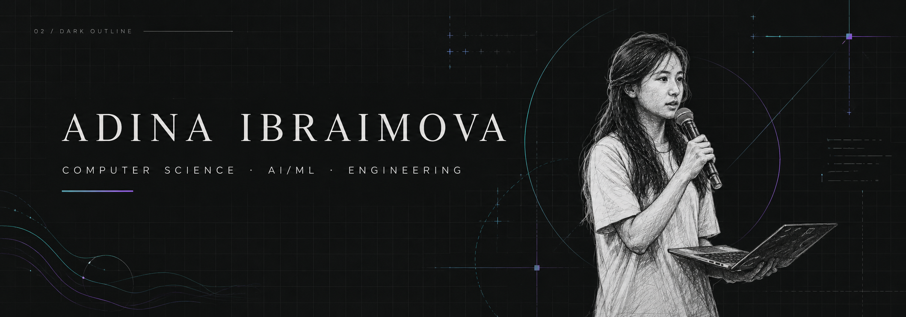

  

<h1 align="center">Adina Ibraimova</h1>

  Computer Science · AI/ML · Engineering

  <a href="https://github.com/ailaris">GitHub</a>
  ·
  <a href="https://www.linkedin.com/in/ailarisio">LinkedIn</a>

---

### Hi, I'm Adina.

I'm a high school student in Astana, Kazakhstan. I spend a lot of my time learning computer science by building projects, experimenting with machine learning, and working with other students on AI and engineering ideas.

Here are some things I've worked on.

### 01 / Astana air quality estimator

<!-- Add a real chart or app screenshot as assets/air-quality-preview.png when available. -->

A machine learning experiment on how well daily weather data can explain air quality changes in Astana.

- Trained and compared Random Forest and linear regression models.
- Tested on 2024 data held out from training on earlier years.
- The final Random Forest model reached an R² of 0.42 on the test year.

The experiment also explores missing data, feature selection, and why weather alone cannot explain all changes in air quality.

[Explore the code and experiments →](https://github.com/ailaris/astana-air-quality)

### 02 / Köz AI

<!-- Add the approved project logo as assets/koz-ai-logo.png when available. -->

An EdTech project exploring the use of computer vision to understand classroom engagement.

I work on the project as a co-founder and AI/CV developer. I'm interested in how visual data can be turned into useful insights, as well as the limitations of interpreting people's behavior through technology.

*Project work in progress.*

### 03 / SynaptiX - Mind-to-Move

<!-- Add the team's Launchpad banner as assets/synaptix-banner.png when available. -->

A collaborative BrainTech project for the NYAS Junior Academy Innovation Challenge.

Our team is exploring an EEG-based brain-computer interface concept in which motor-imagery signals could control a simple robotic-arm action. My role includes leading the team, coordinating research, and helping keep the technical scope realistic.

*Research and concept development in progress.*

### 04 / FTC Robotics

<!-- Add a real robot or team engineering photo as assets/ftc-robot.png when available. -->

My robotics experience includes CAD design, robot building, driving, and engineering documentation with Team Hot Wheels.

I started with CAD during the Into the Deep season and later took on more hands-on building and driving responsibilities. Competition work also taught me the importance of documentation and getting a robot ready under real deadlines.

My teams have received Connect, Inspire, and Think award recognition at regional events.

### Outside my projects

**ZeroHub** - I founded a student-led computer science community where people can explore programming, AI, design, cybersecurity, and other areas of technology.

I also enjoy algorithmic problem-solving, graphic design, and 3D modeling + printing. I'm still figuring out which part of computer science I want to specialize in, so for now I'm building things and learning across several areas.

### Tools I've used

**Programming:** Python · C++ · C

**Data and ML:** NumPy · pandas · scikit-learn · Matplotlib

**Apps and tools:** Streamlit · Git · GitHub

**Other:** 3D modeling (Blender, Onshape, Autodesk Fusion 360, Sharp3D) · Graphic design (Figma, Adobe Illustrator, Adope Photoshop)

I'm still developing my skills in these areas, especially machine learning and software engineering.

---

  my motto is: building, testing, learning, and starting again when necessary.

